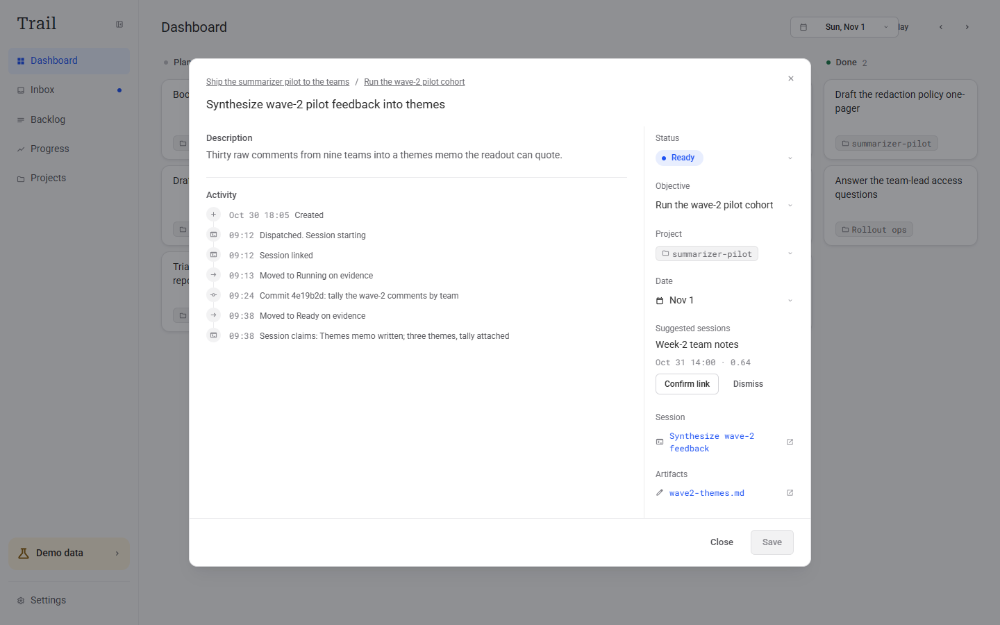

# Trail

Trail is a task tracker that reads my Claude Code sessions, moves planned tasks forward on the commits, files and PRs those sessions contain, and asks me to sign off on what agents claim they finished.



## Try it in 30 seconds

```sh
cd app
npm install
npm run demo
```

The demo runs on a seeded, fictional story, so no local data is needed. Click a task in the Dashboard's Ready column to see the timeline above, then open the Inbox to see what the agents claim they finished.

## What it reads and what it does

- **Intent:** a small tree of standing objectives, with dated tasks linked to the objectives they serve. "Today" and "this week" are views over that tree, not separate lists.
- **Evidence:** read-only ingest of the Claude Code session store (`~/.claude/projects`), including the commits, edited files and PR links inside each transcript. Trail observes; it never writes to the sessions.
- **Reconciliation:** evidence moves tasks forward on its own (Planned to Running to Ready). Only my own move sets Done, so Done is never an agent's claim: claimed completions wait in the Inbox for sign-off.
- **Dispatch:** any task can be handed to a new Claude Code session in Windows Terminal, opened in the task's project folder with the task and its objective chain as the first prompt.

Next: reading git history directly from watched repos, so commits made outside an agent session count too.

## Requirements

- Demo mode runs anywhere Node runs.
- Node 22 or newer.
- Live mode (`npm run dev`) needs Claude Code installed and reads your local sessions.
- Dispatch and open (opening a task's files or folder from Trail) are Windows only: they use Windows Terminal, `cmd` and PowerShell.

## Development

```sh
cd app
npm run dev        # web + API against your local Claude Code sessions
npm test           # vitest suite
npm run typecheck
```

## Why

When execution moves into AI agent sessions, the answer to "what did I actually get done today?" stops living in my head. It lives in transcripts, commits and PR threads I never typed. Every mainstream tracker still assumes the human is the write path for status, which means logging by hand work that is already recorded elsewhere, and that is why personal trackers go stale within days. Trail reads the record instead. The full argument, with research citations, is in [thesis.md](thesis.md).

## License

MIT, see [LICENSE](LICENSE).
